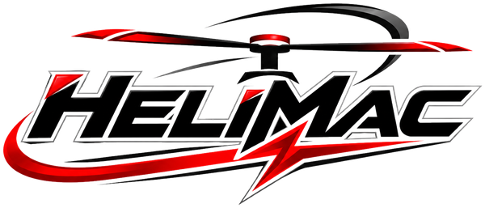
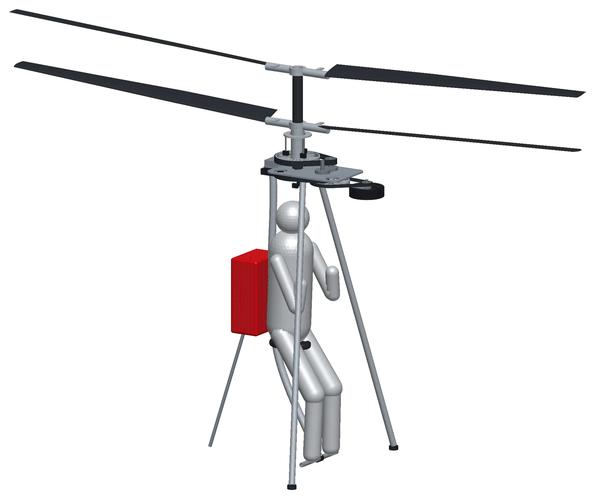

  <a href="https://helimac.pl/en/">
    <picture>
      <source media="(prefers-color-scheme: dark)" srcset="website/assets/img/logo-dark-600.webp">
      
    </picture>
  </a>

<b>Open-source single-seat electric helicopter</b> 
coaxial rotors · weight-shift control · 400 V electric drive · built in the open

  🇬🇧 English · <a href="README.pl.md">🇵🇱 Polski</a> · 🌐 <a href="https://helimac.pl/en/">helimac.pl</a> · ▶️ <a href="https://www.youtube.com/@Helimac-pl">YouTube</a> · ☕ <a href="https://buycoffee.to/helimac">Support</a>

> **Current design: rev K — in design (update 26 Nov 2026: [motor B, rotor, drive, controls, inverter](docs/design-rev-K-2026-11-26.md)).** The machine was recalculated from scratch to cut the mass from 74.9 to ≈ 43.4 kg. Files in [`production/`](production/README.md) are **rev J2 — archive, do not build** (exception: MC-P inverter rev D1 is current). Rev K production packages will follow after stage 3 (CAD + drawings).

---

## Start here

| I want to… | Go to |
|---|---|
| 👀 **see the design** | [Design rev K](docs/design-rev-K.md) + [update 26 Nov](docs/design-rev-K-2026-11-26.md) · [drawings 26 Nov](docs/graphics/revK/2026-11-26/) · [graphics](docs/graphics/revK/) · [layout sketch](docs/graphics/HELIMAC_revK_szkic_ukladu.pdf) · [parameters](docs/parameters.md) · [website](https://helimac.pl/en/) |
| 📦 **download the files** | rev K: [calculations](calc/revK/), [drawings (PDF)](docs/graphics/revK/2026-11-26/), [blade templates (DXF)](hardware/blades/revK-templates/) · rev J2 (archive): [release](../../releases/latest), [production files](production/) · MC-P inverter rev D1 (current): [files](production/electronics/MC-P-inverter-revD1/) |
| 🛠️ **help build it** | [Open tasks (Issues)](../../issues) · [Discussions](../../discussions) · [How to contribute](CONTRIBUTING.md) |
| ▶️ **follow the build** | [YouTube @Helimac-pl](https://www.youtube.com/@Helimac-pl) · [build log](BUILD_LOG.md) · [roadmap](ROADMAP.md) |
| ☕ **support the project** | [buycoffee.to/helimac](https://buycoffee.to/helimac) — every coffee goes to parts and dynamometer tests |

> ⚠️ **Prototype in design — not an approved aircraft.** All values are calculated, not yet measured. Read [SAFETY.md](SAFETY.md) before building anything.

   
  HELIMAC rev K — complete machine (concept model): coaxial rotors Ø 4.5 m, belt drive above the pilot, frame of three aluminium tubes · <a href="docs/graphics/HELIMAC_revK_szkic_ukladu.pdf">layout sketch with dimensions</a> · <a href="docs/graphics/revK/">all rev K graphics</a>

## What is HELIMAC?

A light, single-seat helicopter with a fully electric drive, designed openly with contributors from around the world. Every drawing, calculation, piece of software, test result — and mistake — is published here.

The name combines **HELI**copter and **MAC**iąg — the surname of the founder, **Tomasz Maciąg** from Bydgoszcz, Poland. It continues his original **HeliMac** project (2013–2015), now redesigned from scratch with the help of AI tools. **[Read the story →](ABOUT.md)**

Target category: single-seat ultralight helicopter, MTOM ≤ 300 kg ([Annex I to Regulation (EU) 2018/1139](docs/regulations.md) — national rules instead of EASA certification).

## Current design — rev K (in design)

| | |
|---|---|
| Configuration | coaxial, 2 × 2-blade rotors Ø 4.5 m, 500 rpm, no tail rotor |
| Control | direction by pilot weight shift (no cyclic) · collective by electric actuators · yaw by upper/lower collective difference |
| Pilot | up to 110 kg |
| Take-off mass | ≈ 193 kg (machine without battery ≈ 43.4 kg, battery 40 kg) |
| Hover power | ≈ 16–16.6 kW (1.3 g on a hot day: ≈ 25 kW) |
| Drive | **motor B**: 30 kW continuous, 10 000 rpm, outer rotor with Halbach magnets, ≈ 6 kg → **toothed-belt drive 20:1** (carbon-cord belts, one-way clutch for autorotation, no oil) → coaxial shafts |
| Blades | VR-7 airfoil with trailing-edge tab, foam core, carbon D-spar and skin, tungsten tip mass, ≈ 2.04 kg each |
| Frame | three Al 7075-T6 tubes: two front legs (triangle) + one curved rear leg with seat, footrest and battery |
| Electronics | in-house SiC inverter **MC-P** rev D1 (KiCad) · control board **MC-C** in design |
| Battery | 112S4P Li-ion, ≈ 400 V, ≈ 8 kWh, 40 kg |
| Flight time (calc.) | ≈ 21 min hover / ≈ 28–29 min mixed |
| **Current stage** | **rev K stage 3 — CAD model and drawings**, then production packages and the dynamometer |

Previous version: [rev J2](docs/design-rev-J2.md) (archive) — 74.9 kg without battery, cycloidal + bevel gearbox.

## What's where

| Folder | Inside |
|---|---|
| [production/](production/) | production files — **rev J2 archive** (J1, J2, J3: do not build) and **MC-P inverter rev D1 (current)** |
| [hardware/](hardware/) | assembly overviews with CAD graphics: frame, seat, rotor head & controls, blades, transmission, motor |
| [electronics/](electronics/) | MC-P inverter, MC-C controller, battery + BMS, avionics |
| [docs/](docs/) | [design rev K](docs/design-rev-K.md), [rev J2 (archive)](docs/design-rev-J2.md), parameters, regulations, [graphics (PDF)](docs/graphics/) |
| [calc/](calc/) | performance calculator and [rev K design calculations](calc/revK/) (Python) |
| [firmware/](firmware/) | software (to come) |

## Get involved

We especially welcome aircraft structural engineers, rotor and flight-dynamics specialists, power-electronics and battery engineers, helicopter pilots, aircraft mechanics, makers with 3D printers and CNC, and people who know light-aircraft rules in their country.

1. **Say hello** in [Discussions](../../discussions).
2. **Pick a task** from [Issues](../../issues) — e.g. [#1 400 V inverter review](../../issues/1) or [#6 calculator](../../issues/6) (good first issue).
3. **Read** [CONTRIBUTING.md](CONTRIBUTING.md) and [SAFETY.md](SAFETY.md).

English is the main project language; Polish is equally welcome.

## Licences

Hardware: [CERN-OHL-S-2.0](LICENSES/CERN-OHL-S-2.0.txt) · Software: [GPL-3.0-or-later](LICENSES/GPL-3.0-or-later.txt) · Documentation: [CC-BY-SA-4.0](LICENSES/CC-BY-SA-4.0.txt) · The HELIMAC name and logo are not covered by these licences ([branding/](branding/)). Provided **without any warranty** — see [LICENSE](LICENSE).

---

**Founder & maintainer:** Tomasz Maciąg · Bydgoszcz, Poland · [helimac.pl](https://helimac.pl/en/)
