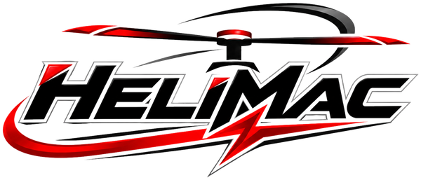
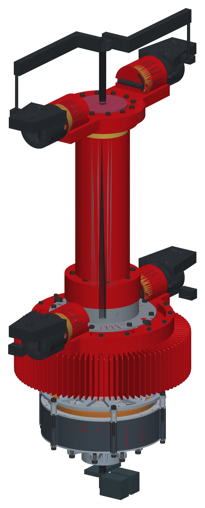

  <a href="https://helimac.pl/">
    <picture>
      <source media="(prefers-color-scheme: dark)" srcset="website/assets/img/logo-dark-600.webp">
      
    </picture>
  </a>

<b>Jednoosobowy śmigłowiec elektryczny — projekt open source</b> 
wirniki współosiowe · sterowanie balansem ciała · napęd elektryczny 400 V · budowany otwarcie

  <a href="README.md">🇬🇧 English</a> · 🇵🇱 Polski · 🌐 <a href="https://helimac.pl/">helimac.pl</a> · ▶️ <a href="https://www.youtube.com/@Helimac-pl">YouTube</a> · ☕ <a href="https://buycoffee.to/helimac">Wesprzyj</a>

---

## Od czego zacząć

| Chcę… | Przejdź do |
|---|---|
| 👀 **zobaczyć konstrukcję** | [Konstrukcja rev J2](docs/design-rev-J2.md) (EN) · [parametry](docs/parameters.md) (EN) · [strona](https://helimac.pl/) |
| 📦 **pobrać pliki** | [Pliki produkcyjne rev J2](production/README.pl.md) — rysunki, DXF, STEP, STL, KiCad, gerbery (ZIP) |
| 🛠️ **pomóc w budowie** | [Otwarte zadania (Issues)](../../issues) · [Discussions](../../discussions) · [Jak współtworzyć](CONTRIBUTING.md) |
| ▶️ **śledzić budowę** | [YouTube @Helimac-pl](https://www.youtube.com/@Helimac-pl) · [dziennik budowy](BUILD_LOG.md) · [plan prac](ROADMAP.md) |
| ☕ **wesprzeć projekt** | [buycoffee.to/helimac](https://buycoffee.to/helimac) — każda kawa to wkład w części i próby na hamowni |

> ⚠️ **Prototyp w fazie projektu — nie jest to dopuszczony statek powietrzny.** Wszystkie wartości są obliczone, jeszcze nie zmierzone. Przed budową przeczytaj [SAFETY.pl.md](SAFETY.pl.md).

   
  Zespół napędowy rev J2: silnik, przekładnia cykloidalna 10:1, przekładnia nawrotna i piasty wirników (model CAD)

## Czym jest HELIMAC?

Lekki, jednoosobowy śmigłowiec z napędem w pełni elektrycznym, projektowany otwarcie razem z ludźmi z całego świata. Publikujemy wszystko: rysunki, obliczenia, oprogramowanie, wyniki prób — i błędy.

Nazwa łączy słowa **HELI**kopter i **MAC**iąg — nazwisko założyciela, **Tomasza Maciąga** z Bydgoszczy. To nawiązanie do jego pierwszego projektu **HeliMac** (2013–2015), dziś zaprojektowanego od nowa z pomocą narzędzi AI. **[Przeczytaj historię →](ABOUT.pl.md)**

Docelowa kategoria: jednomiejscowy śmigłowiec ultralekki, MTOM ≤ 300 kg ([Aneks I do rozporządzenia (UE) 2018/1139](docs/regulations.md) — przepisy krajowe zamiast certyfikacji EASA).

## Aktualna konstrukcja — rev J2

| | |
|---|---|
| Układ | współosiowy, 2 wirniki dwułopatowe Ø 4,5 m, 500 obr/min, bez wirnika ogonowego |
| Sterowanie | kierunek – balans ciała pilota (bez skoku cyklicznego) · skok ogólny – siłowniki elektryczne · kurs – różnica skoku wirnika górnego i dolnego |
| Pilot | do 110 kg |
| Masa startowa | 225,2 kg (maszyna bez akumulatora 74,9 kg, akumulator 40,3 kg) |
| Moc zawisu | 20,7 kW |
| Napęd | silnik PMSM z wirnikiem zewnętrznym (≈ 21 kW w zawisie) → przekładnia cykloidalna 10:1 → przekładnia nawrotna stożkowa |
| Elektronika | własny falownik SiC **MC-P** rev D1 (KiCad) · płytka sterująca **MC-C** w projekcie |
| Akumulator | 112S Li-ion, ≈ 400 V |
| Czas lotu (obliczony) | ≈ 14 min zawis / ≈ 25 min lot mieszany (ogniwa 200 Wh/kg) |
| **Obecny etap** | **Etap 1 — napęd + zasilanie** → hamownia 395 N·m / 30 min, potem 50 h |

## Co gdzie jest

| Folder | Zawartość |
|---|---|
| [production/](production/README.pl.md) | **pliki do wykonania** rev J2 — 4 paczki ZIP (J1 napęd, J2 łopaty, J3 rama i siedzisko, falownik MC-P) |
| [hardware/](hardware/) | opisy zespołów z grafikami CAD: rama, siedzisko, głowica i sterowanie, łopaty, przekładnia, silnik |
| [electronics/](electronics/) | falownik MC-P, sterownik MC-C, akumulator + BMS, awionika |
| [docs/](docs/) | konstrukcja, parametry, przepisy, [grafiki (PDF)](docs/graphics/) |
| [calc/](calc/) | kalkulator osiągów (Python) |
| [firmware/](firmware/) | oprogramowanie (w przyszłości) |

## Jak dołączyć

Szukamy szczególnie: konstruktorów lotniczych, specjalistów od wirników i dynamiki lotu, energoelektroników i specjalistów od akumulatorów, pilotów śmigłowcowych, mechaników lotniczych, majsterkowiczów z drukarkami 3D i CNC oraz osób znających przepisy dla lekkich statków powietrznych.

1. **Przywitaj się** w [Discussions](../../discussions).
2. **Wybierz zadanie** z [Issues](../../issues) — np. [#1 przegląd falownika 400 V](../../issues/1) albo [#6 kalkulator](../../issues/6) (dobre na start).
3. **Przeczytaj** [CONTRIBUTING.md](CONTRIBUTING.md) i [SAFETY.pl.md](SAFETY.pl.md).

Głównym językiem projektu jest angielski, ale po polsku piszemy równie chętnie.

## Licencje

Sprzęt: [CERN-OHL-S-2.0](LICENSES/CERN-OHL-S-2.0.txt) · Oprogramowanie: [GPL-3.0-or-later](LICENSES/GPL-3.0-or-later.txt) · Dokumentacja: [CC-BY-SA-4.0](LICENSES/CC-BY-SA-4.0.txt) · Nazwa i logo HELIMAC nie są objęte tymi licencjami ([branding/](branding/)). Bez jakiejkolwiek gwarancji — patrz [LICENSE](LICENSE).

---

**Założyciel i opiekun projektu:** Tomasz Maciąg · Bydgoszcz, Polska · [helimac.pl](https://helimac.pl/)
