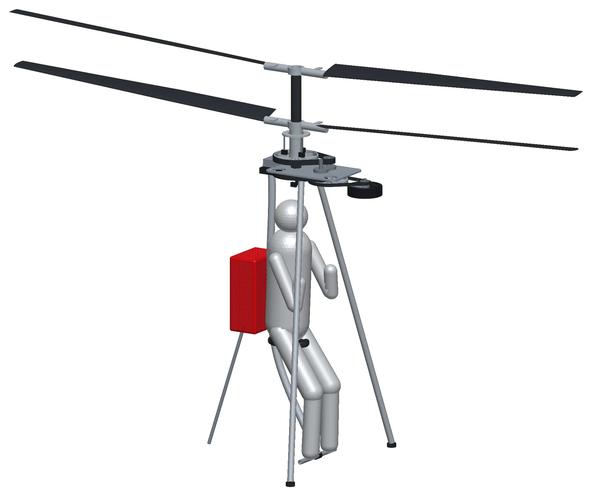

# HELIMAC rev K — redesign from scratch (concept, stage 2)

> 🔄 **Updated 26 Nov 2026:** motor B (30 kW, 10 000 rpm, Halbach — approved), VR-7 blades 2.04 kg, belt drive 20:1, collective control, hub, inverter — see **[design-rev-K-2026-11-26.md](design-rev-K-2026-11-26.md)**. Where the numbers differ, the update applies (machine ≈ 43.4 kg, take-off ≈ 193 kg).

Status: **in progress (23 Nov 2026)**. Rev K replaces rev J2. Do not manufacture rev J2 parts (`production/`, packages J1–J3). The MC-P rev D1 inverter stays.
All values are **calculated, not measured**. Calculation scripts: [`calc/revK/`](../calc/revK/). Graphics: [`docs/graphics/revK/`](graphics/revK/) · [layout sketch](graphics/HELIMAC_revK_szkic_ukladu.pdf).

## Why rev K
Rev J2 came out at 74.9 kg without battery. Most of this was the drive: the cycloidal gearbox plus the bevel reversing gearbox weighed about 20 kg, and the blades about 17 kg (3D-printed ASA cores). The owner set a target of about 40 kg without battery (decision D14), so the whole design was recalculated from the beginning: mass → power → rotor → motor → transmission → controls → electronics → frame.

## Main changes vs rev J2
| Area | rev J2 | rev K |
|---|---|---|
| Transmission | cycloidal 10:1 + bevel reversing gearbox, oil 0.9 l, 2 fans, air-guide ring | **toothed-belt drive 16:1** (carbon-cord 8M belts, 4 × 4; large pulleys with 10 milled spokes): motor → intermediate shaft → 1:1 spur pair reverses direction → two final belts to the coaxial shafts; no oil, efficiency ≈ 97 % |
| Blades | printed ASA core, 4.25 kg each | **PMI foam core, unidirectional carbon D-spar, ±45° carbon skin**, ≈ 2.2 kg each (incl. ≈ 0.67 kg tip mass for autorotation) |
| Motor | 24/20 outer rotor, 56 mm stack, 8 turns, 4970 rpm | same lamination and magnets, **37 mm stack, 7 turns, 8000 rpm**, cooled by rotor downwash (2D FEM scaled from 48 mm: 29.8 N·m at 55 A) |
| Frame | CFRP tripod | **three Al 7075-T6 tubes**: two front legs forming a triangle (Ø40×1.5), one slightly curved rear leg (Ø50×2) carrying seat, footrest, battery and electronics |
| Machine without battery | 74.9 kg | **≈ 43.7 kg** (−42 %) |

## Main parameters (pilot 110 kg, battery 40 kg, ISA sea level)
| Parameter | Value |
|---|---|
| Take-off mass | ≈ 194 kg |
| Rotors | 2 × 2 blades, coaxial counter-rotating, Ø 4.5 m, 500 rpm (tip 118 m/s), spacing 0.38 m |
| Blade | chord 170 mm to r = 1.0 m, taper to 115 mm at tip, twist −12°, NACA 23012-type section |
| Hover power (rotors) | 17.3 kW, figure of merit 0.77 |
| Power 1.3 g, hot day (35 °C, 500 m) | 26.1 kW |
| Minimum cruise power | 11.4 kW at 16 m/s |
| Rotor torque (hover) | 165 N·m per rotor |
| Motor | 8000 rpm, hover 21 N·m / 53 A, max 32 N·m / 81 A, back-EMF ≈ 195 V line-line |
| Battery | 112S4P Li-ion (448 × 21700 high-power cells), ≈ 403 V nominal, ≈ 8 kWh, 40 kg |
| Flight time | ≈ 19.7 min hover / ≈ 25.8 min mixed (30 % hover, 70 % cruise), landing at 20 % charge |
| Autorotation | rotor speed falls 500 → 425 rpm in 0.45 s after power loss; automatic collective drop completes in ≈ 0.25 s; descent ≈ 6 m/s in forward flight at 16 m/s |
| Rotor heights | lower 2.35 m, upper 2.73 m above ground |
| Frame footprint | front feet 1.40 m apart, front-to-rear 1.95 m; frame apex 2.05 m |

## Checks done in stage 2
- Belts: stage 1 26T/104T 21 mm (≈ 28 m/s, effective tension ≈ 1.0 kN), final stages 30T/120T 36 mm (1.67 kN, 8 m/s) — widths to be confirmed with the belt maker's selection software.
- Spoked pulleys (Al 7075-T6, milled): 3–12 spokes compared; fewer spokes need a much thicker rim (5 spokes: 2.2 kg, 10 spokes: 1.4 kg for the 120T pulley) → **10 spokes** on the large pulleys, rim deflection between spokes ≤ 0.1 mm, fatigue stress ≤ 70 MPa.
- Reversing spur pair m 2, z 50, b 20 mm, case-hardened: bending 97 MPa, contact 540 MPa.
- Fixed column Al 7075-T6 Ø70×4: safety 11 against yield at ultimate load (hub moment from weight-shift control included).
- Blade: root spar stress ≈ 270 MPa (allowable 600 MPa); flap ≈ 1.25/rev, lag ≈ 1.4/rev, torsion > 10/rev; centre of gravity ≤ 25 % chord; centrifugal force 7.7 kN.
- Pitch bearing: thrust bearing static safety 5.4.
- Collective: pitch-axis moment ≈ 2.8 N·m per blade; 5 servos as before (2 upper, 3 lower) have enough rated force.
- Frame at 3 g landing: front legs buckling safety 2.9; rear leg bending 270 MPa, needs an internal sleeve at the seat (FEM check next).

## Weight reductions applied (23 Nov 2026)
Lighter 8000 rpm motor (−1.8 kg), hubs integrated with blade grips (−0.8), spoked pulleys, inverter heatsink in rotor downwash without fans (−0.5), smaller blade tip masses with faster automatic collective drop (−1.2), carbon column and upper drive tube (−1.0), lightweight seat (−0.7), shorter 400 V cables (−0.4). The detailed belt drive came out 1.5 kg heavier than the first estimate (realistic pulley masses). Result: **≈ 43.7 kg**. With carbon frame tubes instead of aluminium it would be ≈ 41.5 kg (not chosen).

## Next (stage 3)
CAD model and drawings, motor mechanical design (shaft, pulley, bearings), belt drive drawings, hub and blade drawings with lay-up, frame FEM and joints, battery pack (two 56S4P halves with BMS), mass and centre-of-gravity check, then production packages rev K.
