# HELIMAC rev K — graphics · grafiki

From the rev K **concept model** and calculations (23 Nov 2026). Calculated, not measured. Labels inside the PDFs are in Polish.
*Z modelu koncepcyjnego rev K i obliczeń (23.11.2026). Obliczenia, nie pomiary.*

> 🔄 **Newer drawings (26 Nov 2026):** motor B, rotor, blades, belt drive 20:1, collective control, hub, actuators, rings, inverter — **[2026-11-26/](2026-11-26/)**. The concept graphics below show the 23 Nov state (motor 8000 rpm, drive 16:1).

## PDF (A4)

| PDF | Contents · Zawartość |
|---|---|
| [HELIMAC_revK_1_maszyna.pdf](HELIMAC_revK_1_maszyna.pdf) | complete machine, frame · cała maszyna, rama |
| [HELIMAC_revK_2_naped.pdf](HELIMAC_revK_2_naped.pdf) | drive unit, belt drive, spoked pulley · napęd, przekładnia pasowa, koło ze szprychami |
| [HELIMAC_revK_3_silnik.pdf](HELIMAC_revK_3_silnik.pdf) | motor, 2D FEM · silnik, MES 2D |
| [HELIMAC_revK_4_lopaty.pdf](HELIMAC_revK_4_lopaty.pdf) | blade construction · budowa łopaty |
| [HELIMAC_revK_5_elektronika.pdf](HELIMAC_revK_5_elektronika.pdf) | MC-P inverter rev D1 (unchanged), wiring diagram · falownik MC-P rev D1 (bez zmian), schemat połączeń |
| [../HELIMAC_revK_szkic_ukladu.pdf](../HELIMAC_revK_szkic_ukladu.pdf) | layout sketch with dimensions · szkic układu z wymiarami |

## Images · Obrazy

### HELIMAC rev K – complete machine (concept model)
*HELIMAC rev K – cała maszyna (model koncepcyjny)*

[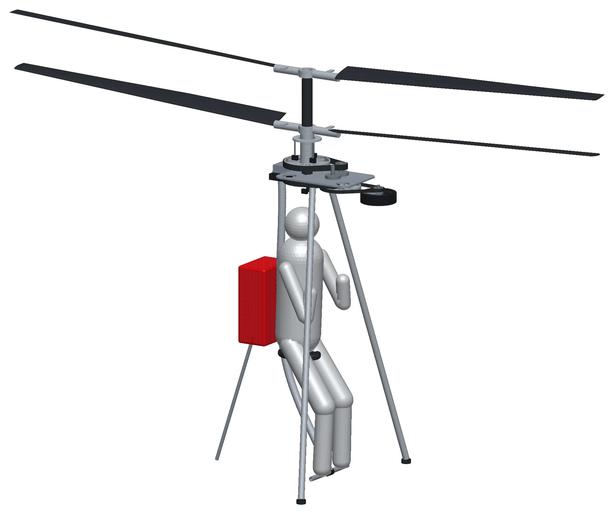](helimac_K01_maszyna.webp)

### Frame of 3 aluminium tubes: front triangle, rear leg curved towards the feet carrying seat, footrest and battery
*Rama z 3 rur aluminiowych: trójkąt z przodu, noga tylna wygięta w stronę nóg z siodełkiem, podnóżkiem i akumulatorem*

[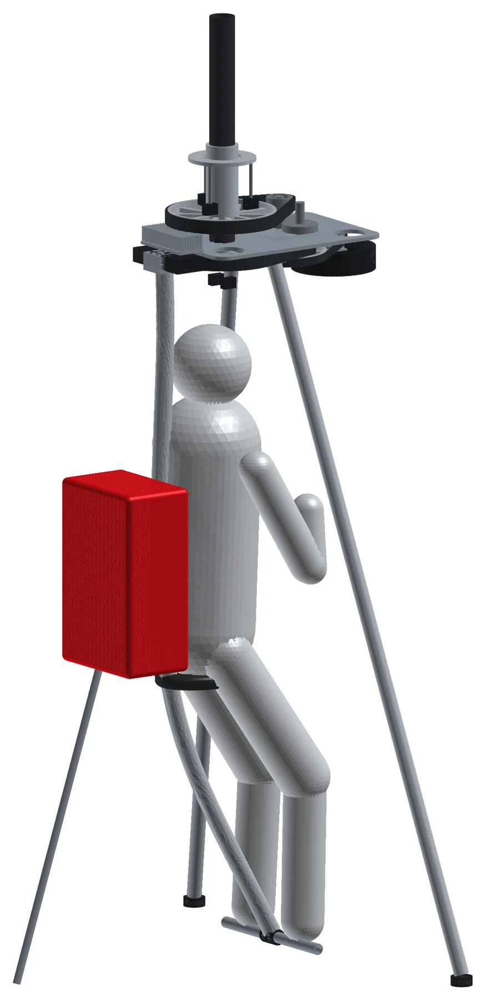](helimac_K02_rama_pilot.webp)

### Layout sketch – side and front view, dimensions
*Szkic układu – widok z boku i z przodu, wymiary*

[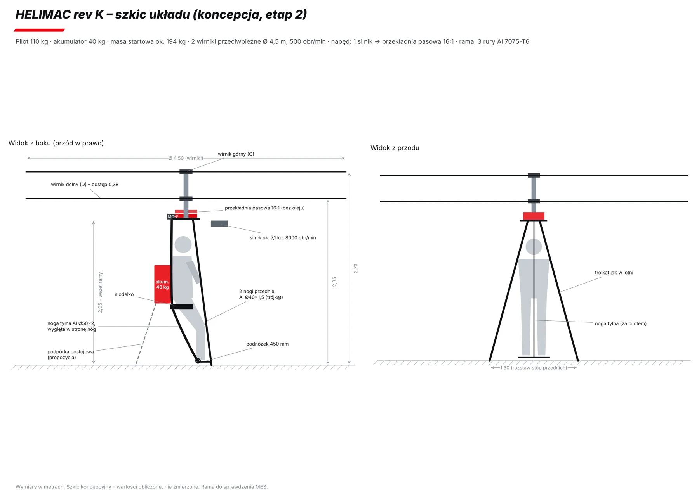](helimac_K00_szkic_ukladu.webp)

### Drive unit: motor, 16:1 belt drive, reversing gears, lower rotor hub
*Zespół napędowy: silnik, przekładnia pasowa 16:1, koła nawrotne, piasta wirnika dolnego*

[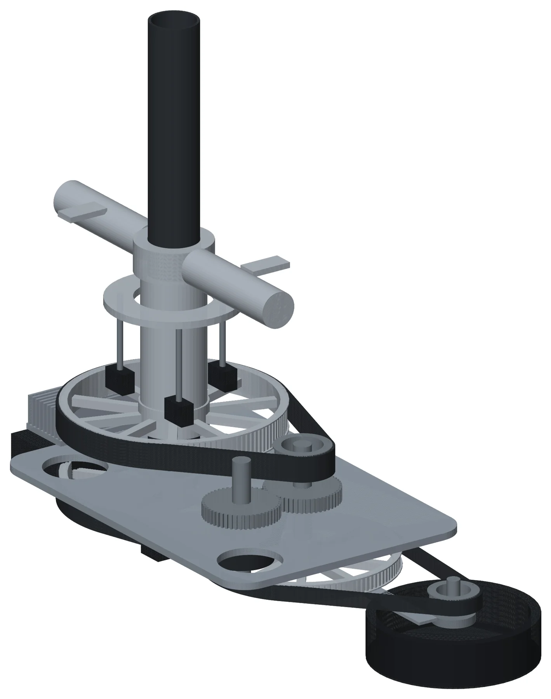](helimac_K03_naped.webp)

### How the belt drive works – top view and levels
*Jak działa przekładnia pasowa – widok z góry i poziomy*

[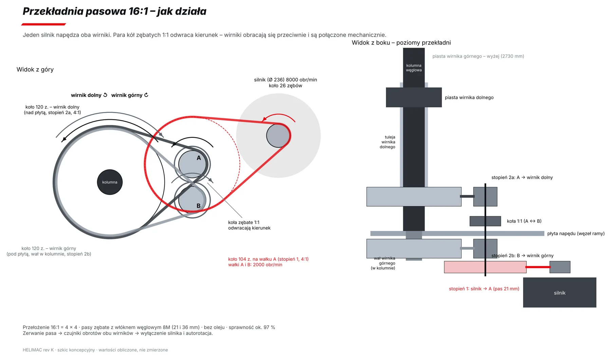](helimac_K06_przekladnia_pasowa_schemat.webp)

### 120-tooth pulley with 10 milled spokes (approx. 1.4 kg)
*Koło pasowe 120 zębów z 10 szprychami frezowanymi (ok. 1,4 kg)*

[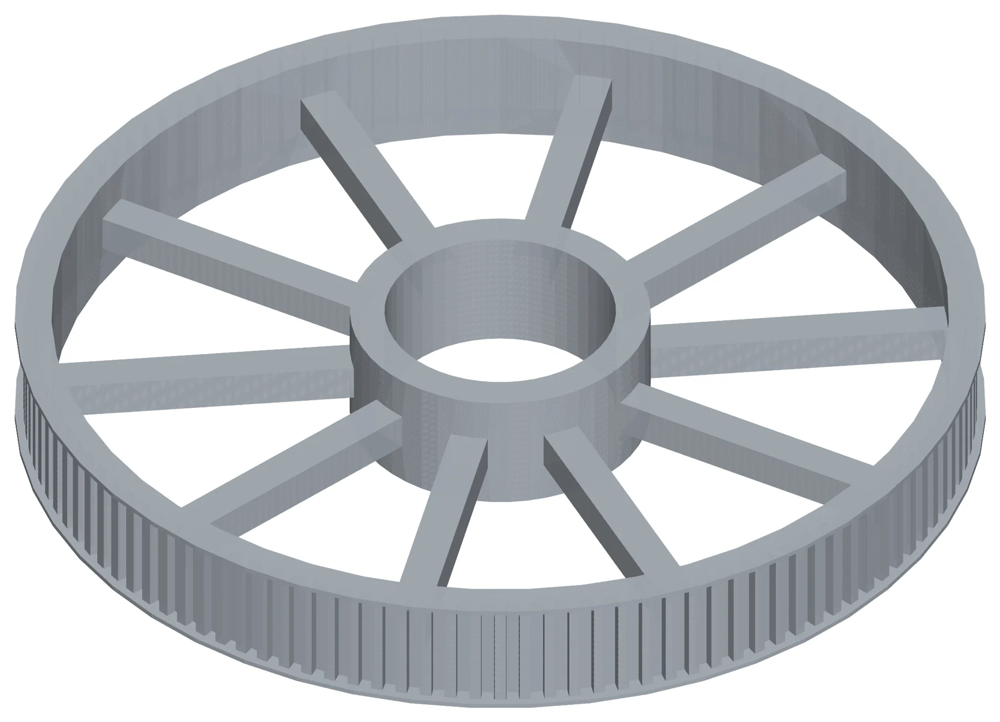](helimac_K05_kolo_pasowe_10_szprych.webp)

### Blade: foam core, carbon-fibre spar, approx. 2.2 kg
*Łopata: rdzeń z pianki, dźwigar z włókna węglowego, ok. 2,2 kg*

[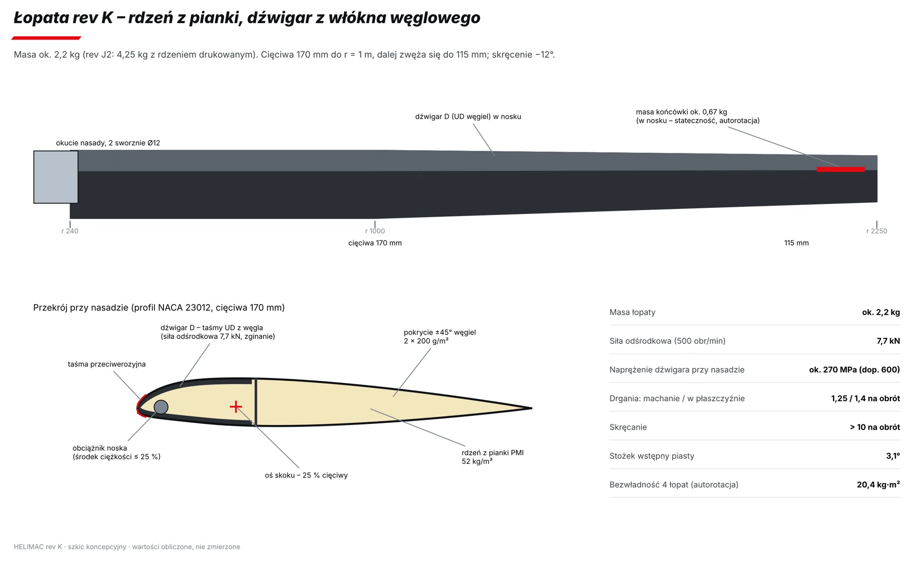](helimac_K07_lopata_budowa.webp)

### 24/20 motor, 37 mm stack – wound stator, magnets, rotor
*Silnik 24/20, pakiet 37 mm – stojan z uzwojeniem, magnesy, wirnik*

[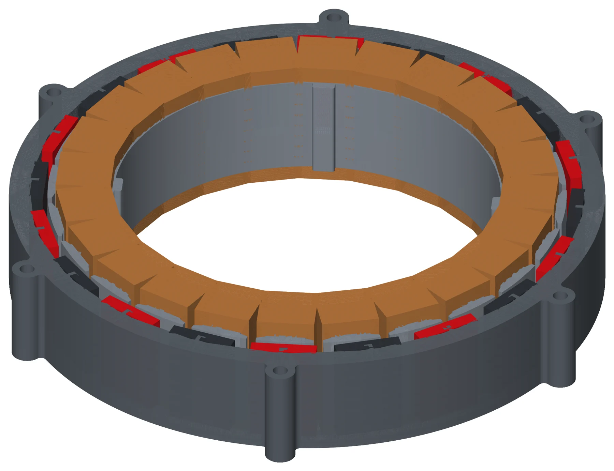](helimac_K08_silnik.webp)

### Magnetic field at hover, 53 A (2D FEM)
*Pole magnetyczne w zawisie, 53 A (MES 2D)*

[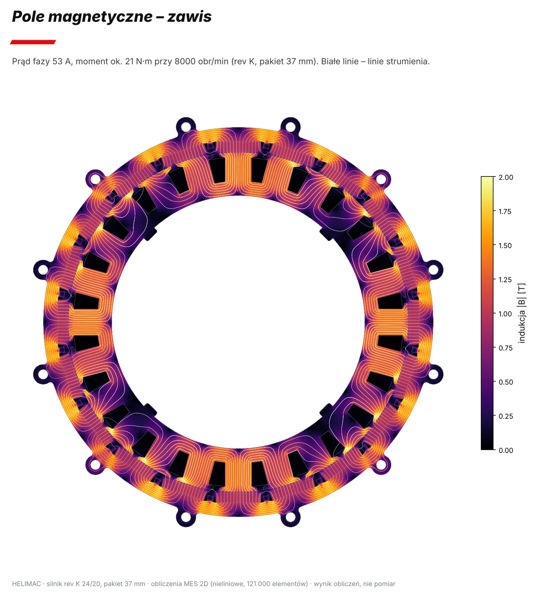](helimac_K51_silnik_MES_pole_zawis.webp)

### Magnetic field – close-up (2D FEM)
*Pole magnetyczne – zbliżenie (MES 2D)*

[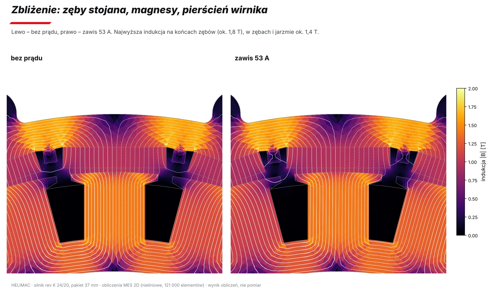](helimac_K52_silnik_MES_zblizenie.webp)

### Back-EMF and torque (2D FEM)
*Napięcie indukowane i moment (MES 2D)*

[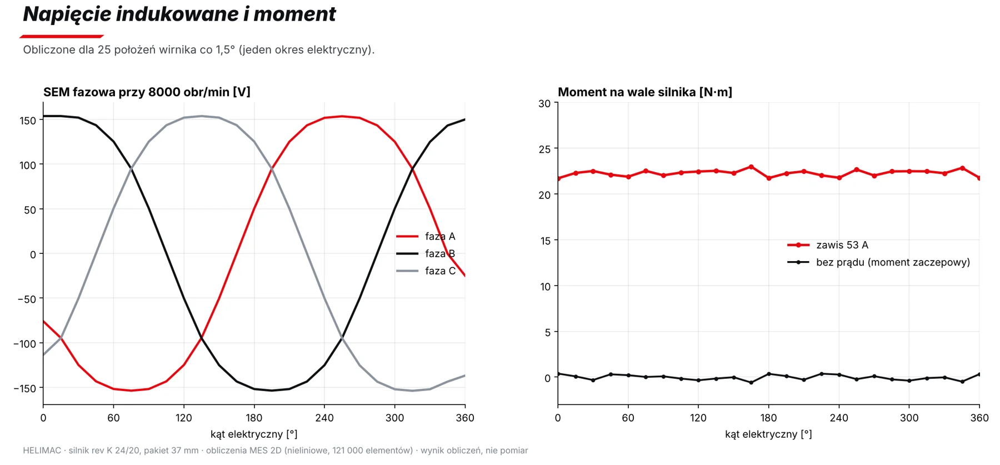](helimac_K54_silnik_MES_SEM_moment.webp)

Licence: CC-BY-SA-4.0 (documentation). The HELIMAC name and logo are not covered — see [branding/](../../../branding/).
