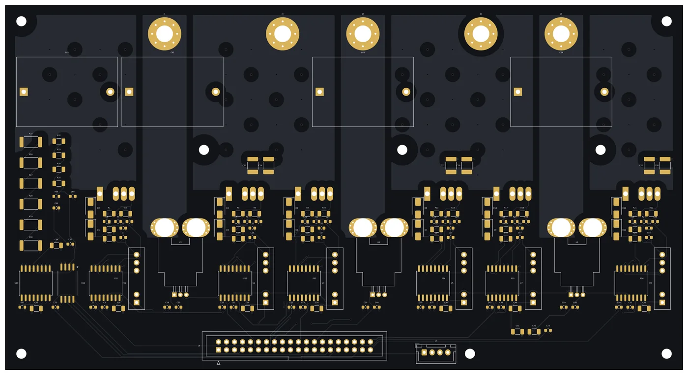
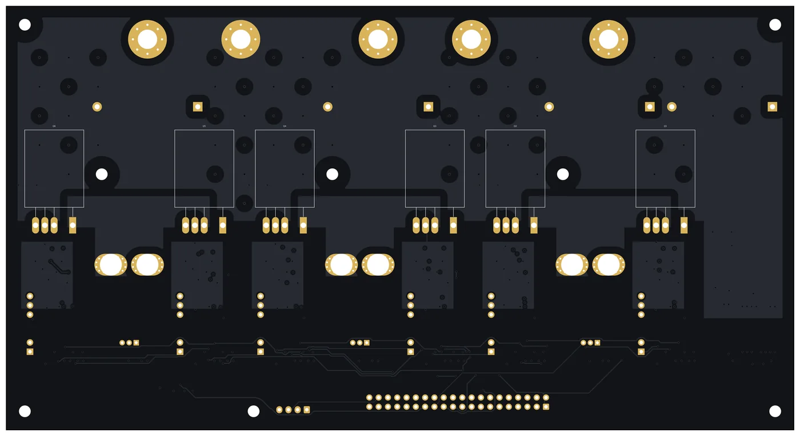
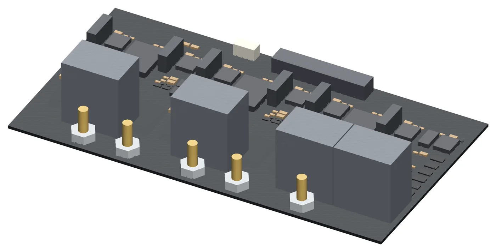
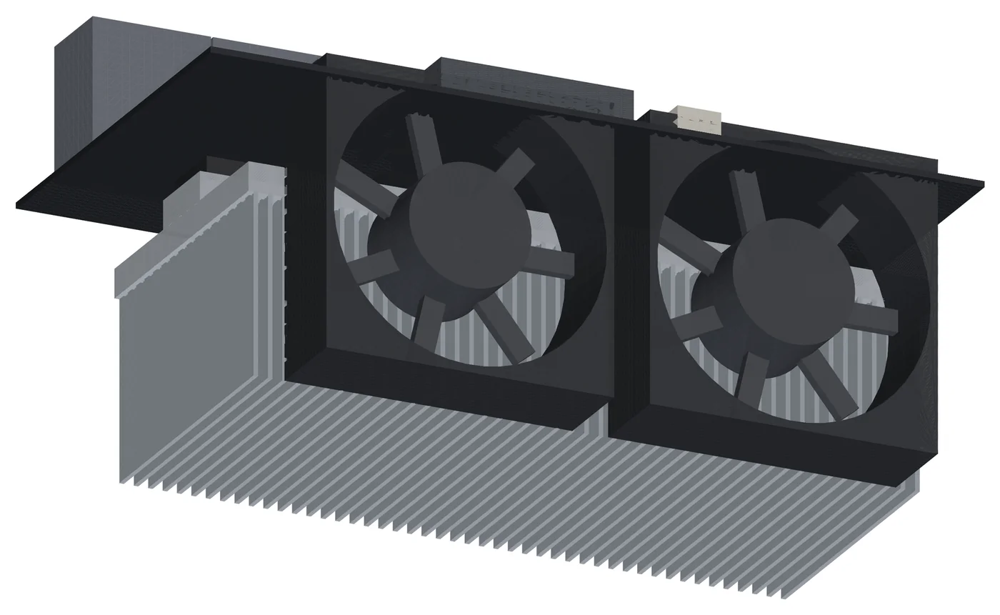

# MC-P — inverter power board

**Current revision: rev D1** (design rev J2, pilot 110 kg) · **Status:** 📐 designed, DRC clean — 400 V design review pending before manufacture
Revisions B, C and D are withdrawn — do not build.

## Files

**Production files:** [MC-P inverter rev D1](../../production/electronics/MC-P-inverter-revD1/) · [ZIP](../../production/downloads/HELIMAC_MC-P_inverter_revD1.zip)

KiCad 7 project, Gerbers, BOM and CPL (LCSC part numbers), schematic PDF, mechanical drawing, STEP, DRC report, heatsink calculation.

**Rev K:** MC-P rev D1 is unchanged; in rev K the heatsink sits in the rotor downwash (no fans). Graphics and wiring diagram: [HELIMAC_revK_5_elektronika.pdf](../../docs/graphics/revK/HELIMAC_revK_5_elektronika.pdf).

## CAD graphics (rev J2 board — still current)

From the rev J2 CAD model (design chat, 22.11.2026). Click an image for full size.

  
*Component side: isolated gate drivers, current sensors, film capacitors, power terminals along the top edge*

  
*Transistor side: six SiC transistors in TO-247-4 packages, clipped to the heatsink*

  
*Board in 3D (simplified component bodies from package dimensions)*

  
*With the 190 × 80 mm heatsink and two 80 mm fans blowing across the fins*

Rev D1 = rev D with one BOM change: Q1–Q6 **C3M0016120K** instead of C3M0021120K (same TO-247-4 footprint; board and Gerbers unchanged).

## Operating point (rev J2)

| Quantity | Hover | Climb |
|---|---|---|
| Phase current | 56 A | 86 A |
| DC current | 69 A | 119 A (peak) |
| Losses | 287 W | — |
| Junction temp. at 40 °C ambient | ≈ 99 °C | — |

DC wiring: 25 mm² cables, fuse and contactor ≥ 125 A continuous.

## Board

- 215 × 116 mm, 4 layers, 1.6 mm, 2 oz copper on all layers.
- 6 × SiC MOSFET C3M0016120K (TO-247-4, bottom side, tab to heatsink, spring-clip mounting — no holes in the board).
- 6 × UCC21750 gate drivers with DESAT protection, 6 × QA151C3 isolated supplies.
- 3 × ACS758 current sensors (between high and low switch of each phase).
- DC bus voltage measurement: AMC1311 with UCC12050 isolated supply.
- 4 film capacitors mounted horizontally above the transistors.
- M5 terminals on the top edge: Phase A (50; 9), DC+ (88; 9), Phase B (114; 9), DC− (151; 9), Phase C (176; 9).
- DC bus: 4 planes, 66 stitching vias.

### Isolation clearances

| Between | Clearance |
|---|---|
| 400 V nets, outer layers | 2.0 mm |
| 400 V nets, inner layers | 0.8 mm |
| Low voltage ↔ 400 V | 4.9 mm |
| 400 V copper ↔ board edge | ≥ 3 mm |
| Mounting hole edge ↔ 400 V copper | ≥ 3.4 mm |

DRC: 0 unrouted, 0 clearance/hole violations; schematic ↔ PCB 159/159.

### Connector J6 to MC-C
PWM_BL = pin 16, PWM_CH = pin 40, PWM_CL = pin 39; pins 15, 17, 18, 19 = GND.

## Cooling

- Heatsink AlMgSi: base 190 × 80 × 8 mm, pedestal 190 × 22 × 8 mm, fins 50 mm (1.2 mm thick, 2.8 mm gap).
- 2 × Noctua NF-A8 PWM blowing across the fins, controlled by MC-C (PWM 25 kHz + TACH, stall alarm). One fan along the fins was calculated as insufficient (heatsink ≈ 98 °C in hover).
- Thermal model is simplified (± ~30 %) — to be confirmed by measurement.

## Before first power-up

1. Insulation test 1.5 kV DC: 400 V circuits vs. low-voltage ground and vs. heatsink, leakage < 1 mA.
2. First power-up from a current-limited laboratory supply.
