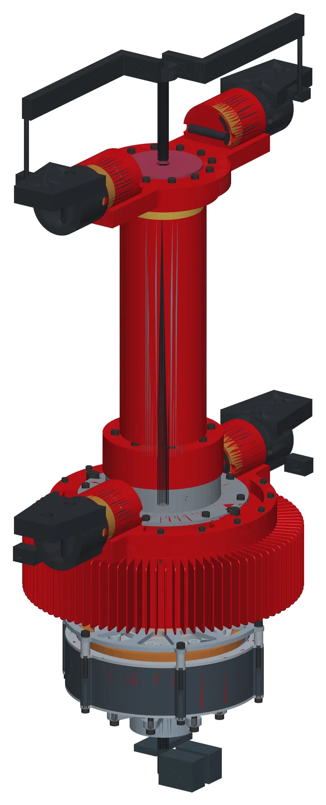
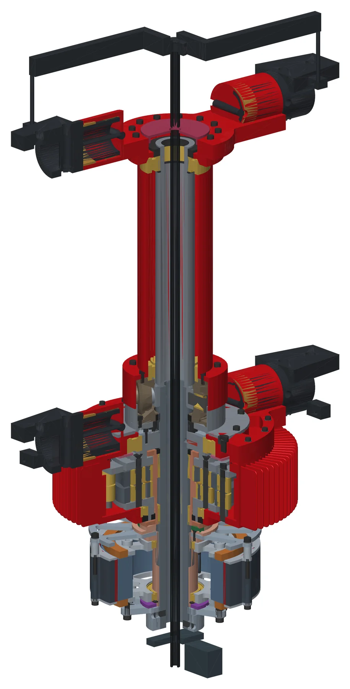

# Mechanical design

> 🛑 **Current design: [rev K](../docs/design-rev-K.md) (in design).** The CAD graphics and production files linked from these pages are **rev J2 — archive, do not build**. Rev K layout: [sketch](../docs/graphics/HELIMAC_revK_szkic_ukladu.pdf).

Licence: CERN-OHL-S-2.0. Each assembly has its own folder with a `README.md` listing files and their status.
File formats: source CAD + `.step` + `.pdf` drawing.

**Production files rev J2 (drawings, DXF, STEP, STL — ZIP downloads): [../production/](../production/)**

## Drive unit (rev J2 — archive)

Motor → cycloidal transmission 10:1 → reversing bevel gearbox → coaxial rotors. Assemblies: [motor](motor/), [transmission](transmission/), [rotor head & controls](rotor-head-and-controls/), [blades](blades/).

  
*Drive unit — overall view*

  
*Quarter section: the upper rotor collective rod runs through the centre of the column*

