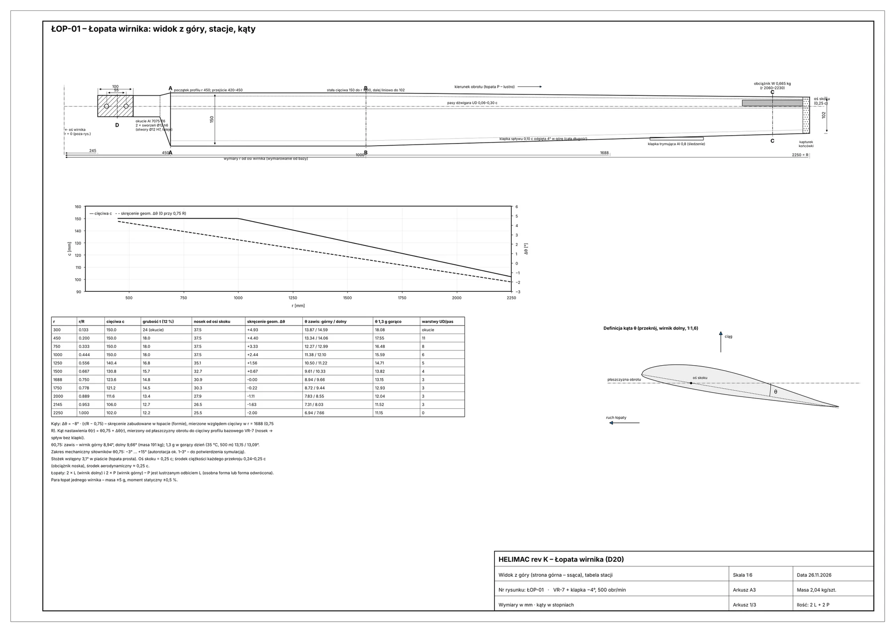
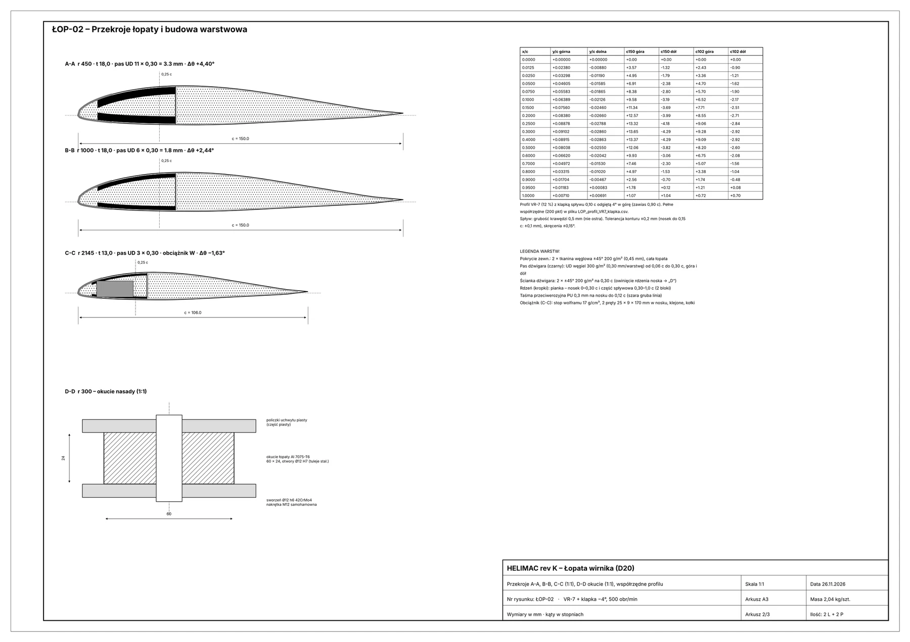
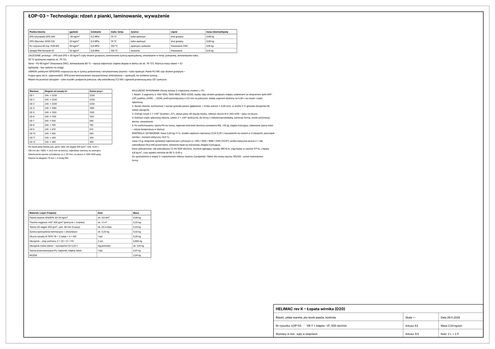
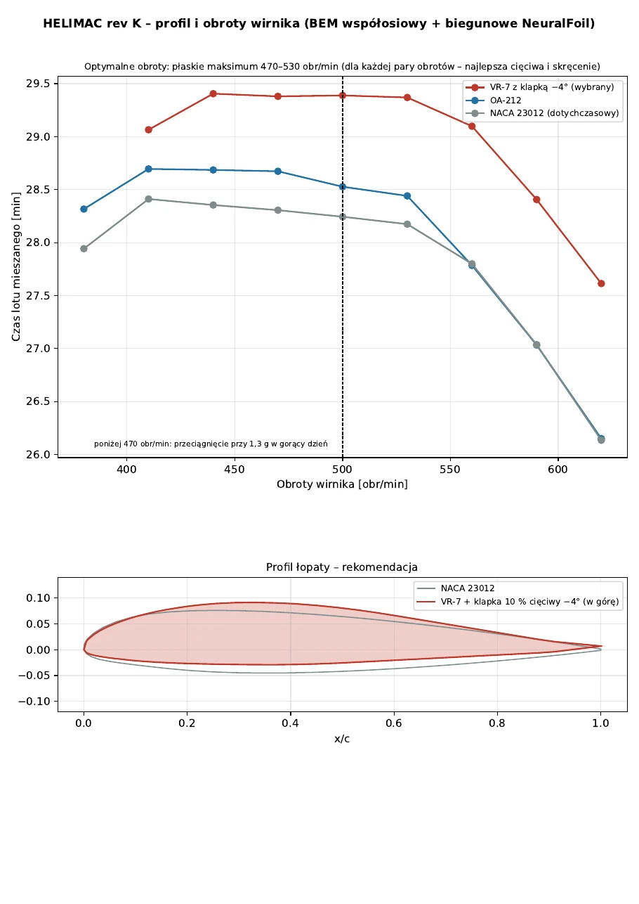
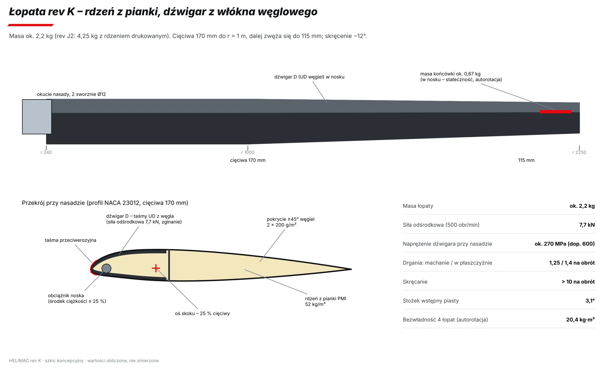
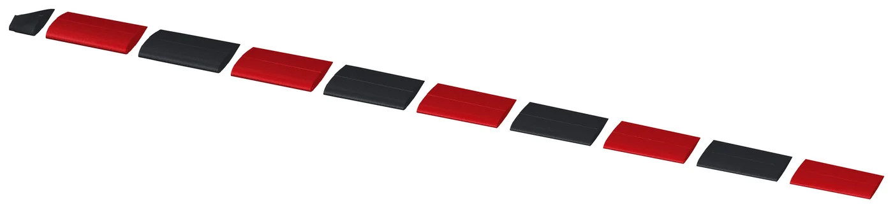

# Rotor blades

**Status:** 🔄 **rev K blade — recommended (D20)**: VR-7 with 4° tab, chord 150 → 102 mm, twist −8°, foam core + carbon D-spar, tungsten tip mass, 2.04 kg; hot-wire templates in [revK-templates/](revK-templates/) ([update 26 Nov](../../docs/design-rev-K-2026-11-26.md#4-blades-drawings-łop-0103)). Rev J (ASA core) — archive, do not build.

**Onshape document:** _link to be added_

## Files

**Production files (rev J2 — archive):** [J2 – rotor blades rev J](../../production/mechanical/J2-blades-revJ/) · [ZIP](../../production/downloads/HELIMAC_J2_blades_revJ.zip)

Blade drawings W-00…W-05 (lower D, mirrored upper G), manufacturing process WL-01, CNC section data, 3D-print STL of ASA core segments and jigs (ZIP).

## Drawings 26 Nov 2026 (blades ŁOP-01…03 — recommended)

Hot-wire templates (DXF) and VR-7 coordinates: [revK-templates/](revK-templates/).

PDF (A3): [HELIMAC_revK_LOP_rysunki_lopaty.pdf](../../docs/graphics/revK/2026-11-26/HELIMAC_revK_LOP_rysunki_lopaty.pdf)

  
*ŁOP-01*

  
*ŁOP-02*

  
*ŁOP-03*

  
*Rotor airfoil and speed (D20)*

## CAD graphics (rev K concept, 23 Nov 2026)

From the rev K concept model (23 Nov 2026) — calculated, not measured.

  
*Blade: foam core, carbon-fibre spar, approx. 2.2 kg*

PDF: [HELIMAC_revK_4_lopaty.pdf](../../docs/graphics/revK/HELIMAC_revK_4_lopaty.pdf)

## CAD graphics (rev J2 — archive)

From the rev J2 CAD model (design chat, 22.11.2026). Click an image for full size.

  
*Core of 10 segments — each fits a 256 × 256 mm print bed; colours show the split into parts*

  
*Blade root: flange and the first core segments*

## Notes

## Open questions
