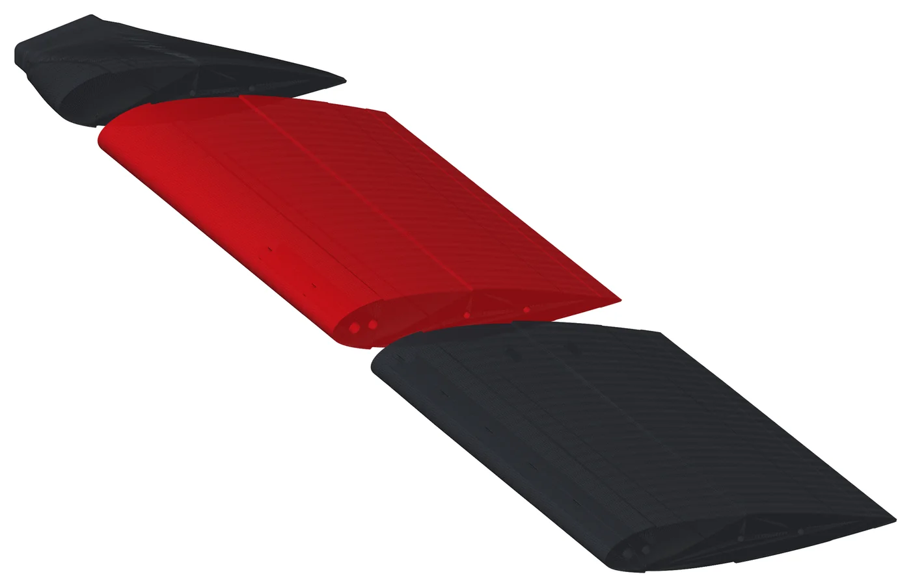

# Rotor blades

**Status:** 📐 rev J2 designed — CAD graphics below; source files to be published

## CAD graphics (rev J2)

From the rev J2 CAD model (design chat, 22.11.2026). Click an image for full size.

  
*Core of 10 segments — each fits a 256 × 256 mm print bed; colours show the split into parts*

  
*Blade root: flange and the first core segments*

**Onshape document:** _link to be added_

## Files

| File | Description | Status | Revision |
|---|---|---|---|
| | | | |

## Notes

## Open questions
