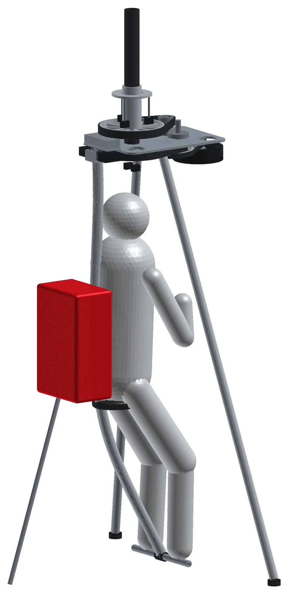
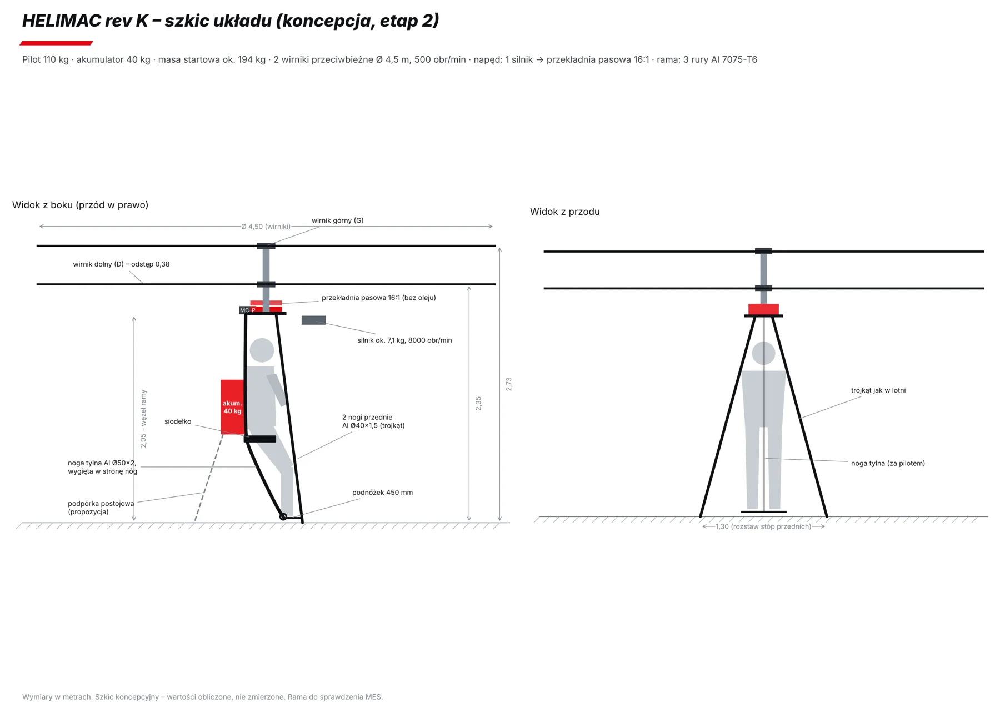

# Frame (incl. CFRP legs)

**Status:** 🛑 **Rev J2 CFRP tripod — archive, do not build.** Rev K frame: three Al 7075-T6 tubes (front Ø40×1.5 ×2, curved rear Ø50×2), FEM check pending ([rev K](../../docs/design-rev-K.md)).

**Onshape document:** _link to be added_

## Files

**Production files (rev J2 — archive):** [J3 – frame, seat, PK ring, lower collective rev J2](../../production/mechanical/J3-frame-seat-revJ2/) · [ZIP](../../production/downloads/HELIMAC_J3_frame_seat_revJ2.zip)

Frame drawings in `01_RYSUNKI/`, STEP in the ZIP. A new layout (hang-glider style front triangle + single rear leg) is being calculated.

## CAD graphics (rev K — current)

From the rev K concept model (23 Nov 2026) — calculated, not measured.

  
*Frame of 3 aluminium tubes: front triangle, rear leg curved towards the feet carrying seat, footrest and battery*

  
*Layout sketch – side and front view, dimensions*

PDF: [HELIMAC_revK_1_maszyna.pdf](../../docs/graphics/revK/HELIMAC_revK_1_maszyna.pdf)

## Notes

## Open questions
