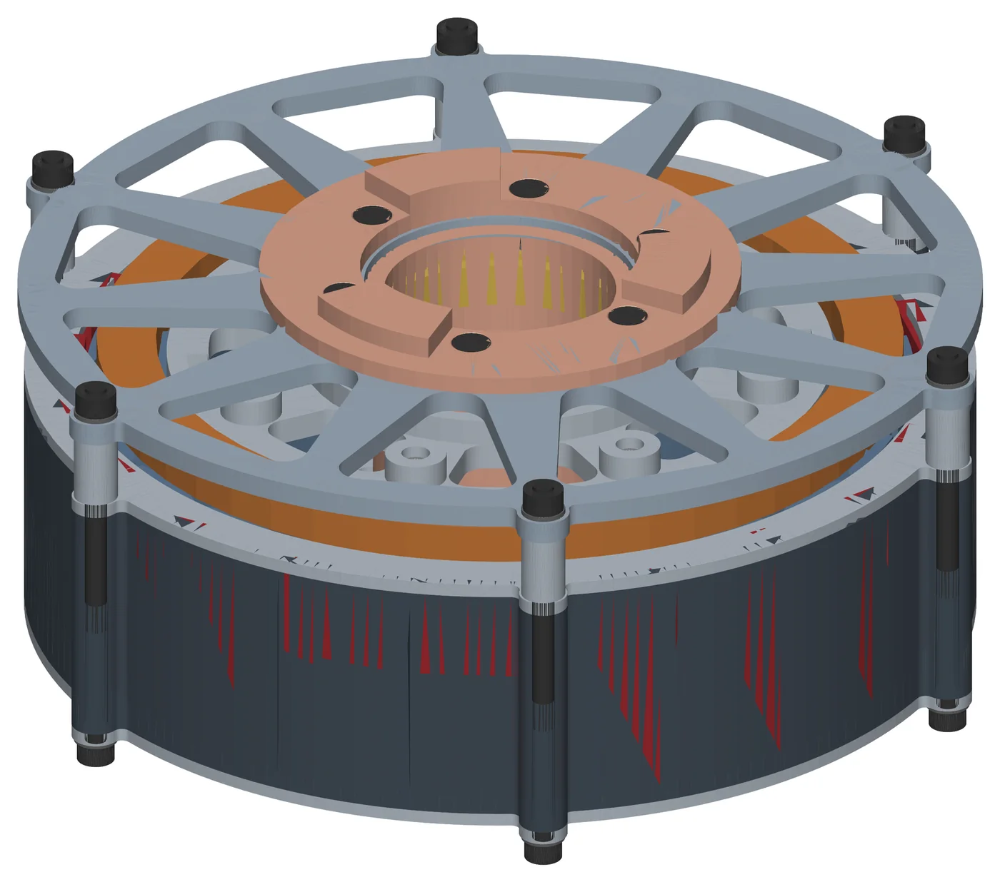
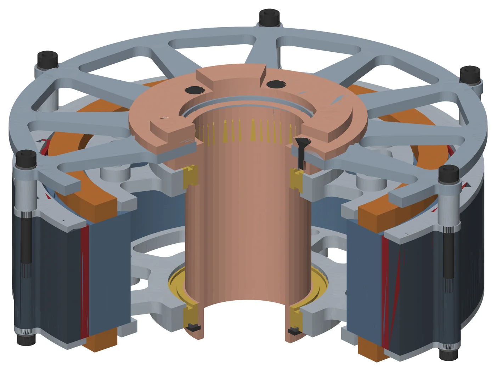

# Electric motor (radial flux)

**Status:** 📐 rev J2 designed — CAD graphics below; source files to be published

## CAD graphics (rev J2)

From the rev J2 CAD model (design chat, 22.11.2026). Click an image for full size.

  
*The outer rotor turns around the stationary stator*

  
*Section: lamination stacks, winding and bearings on the column*

  
*Stator: 24 slots, concentrated winding, 2 parallel paths; 0.2 mm laser-cut laminations*

**Onshape document:** _link to be added_

## Files

| File | Description | Status | Revision |
|---|---|---|---|
| | | | |

## Notes

## Open questions
