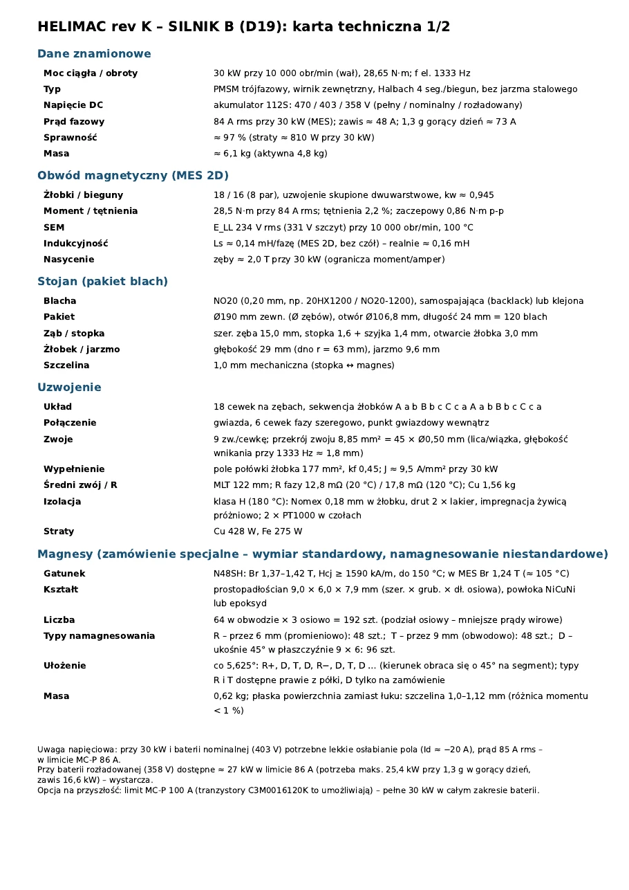
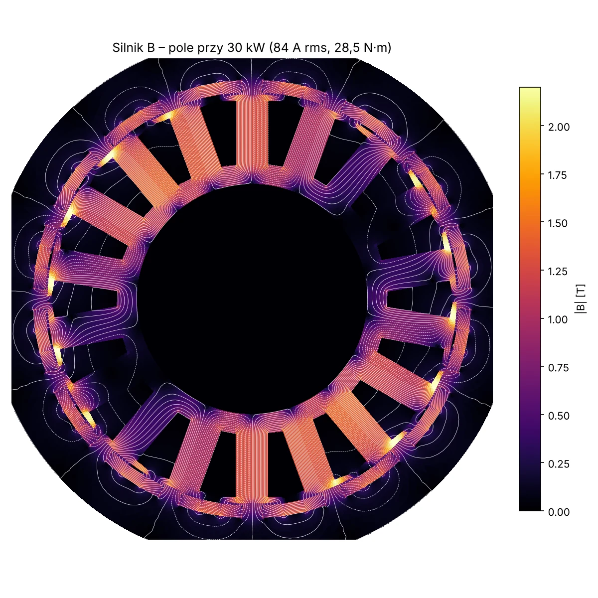
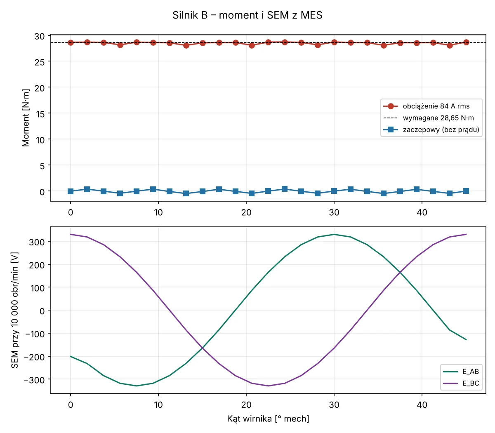
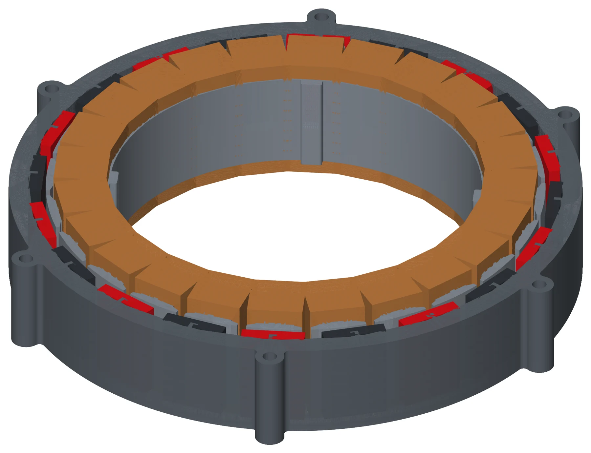
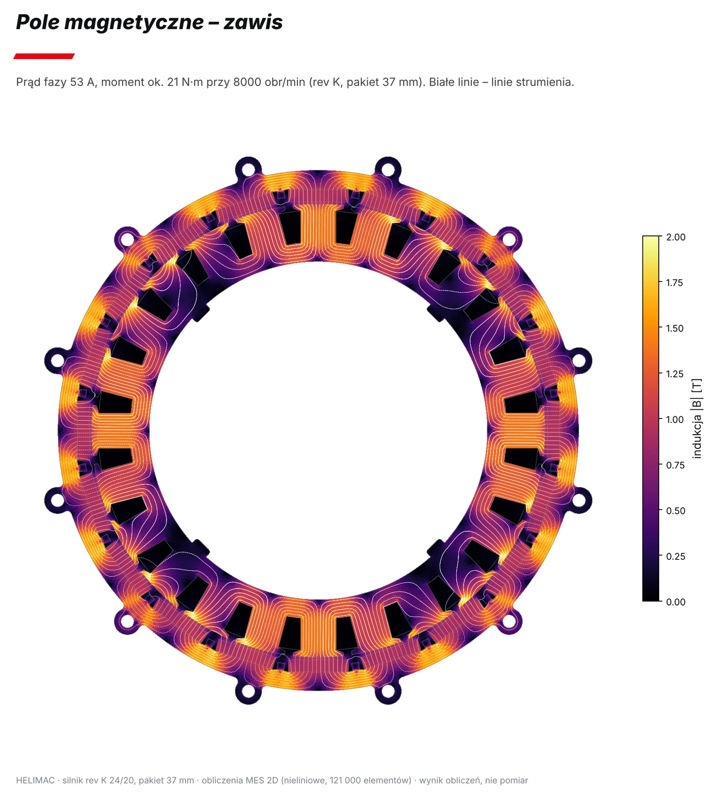
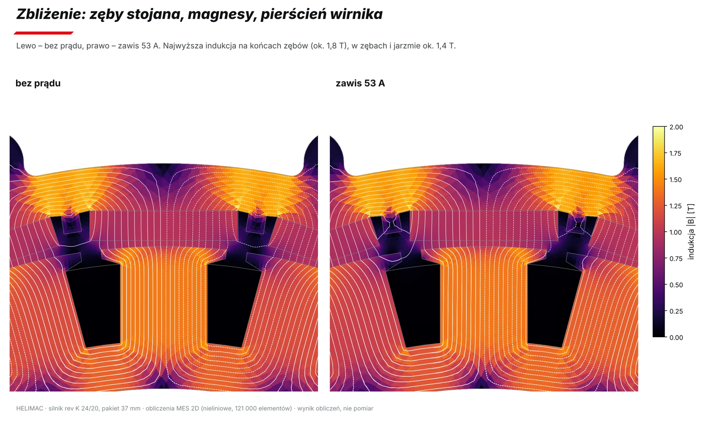
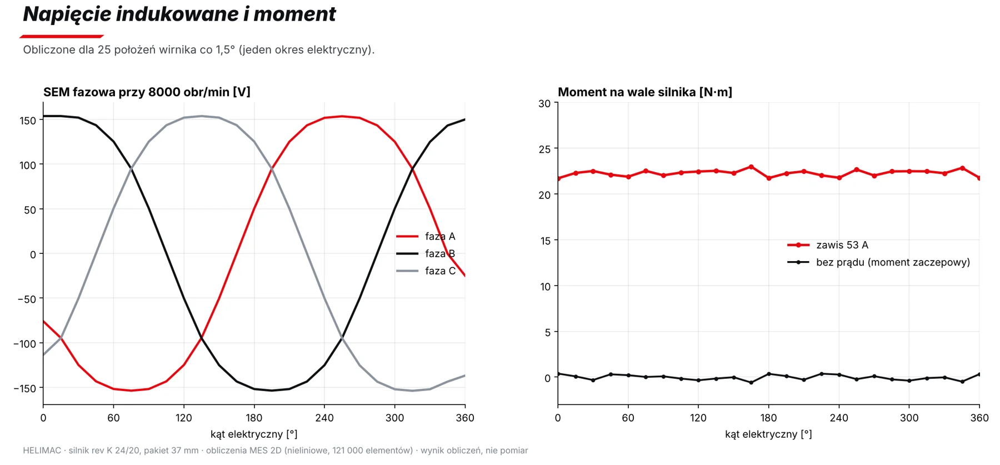
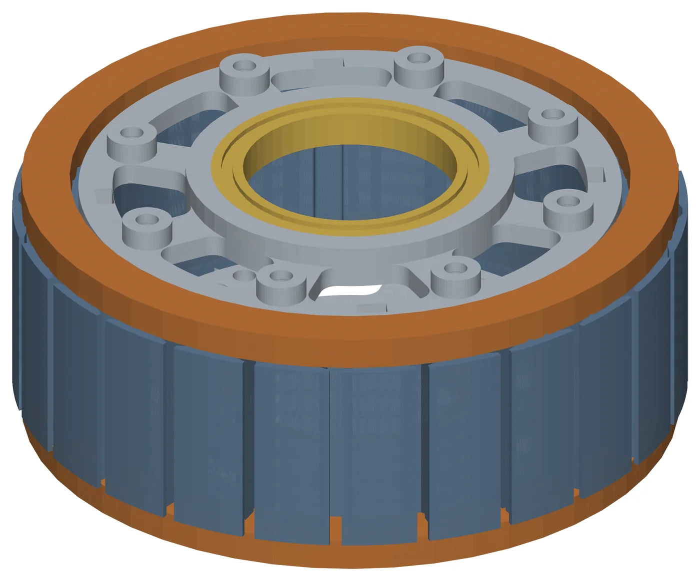

# Electric motor (radial flux)

**Status:** ✅ **rev K motor B approved (D19)** — 30 kW continuous, 10 000 rpm, outer rotor with Halbach magnets, 18/16, Ø 214 mm, 24 mm stack, ≈ 6 kg ([update 26 Nov](../../docs/design-rev-K-2026-11-26.md#2-motor-b--30-kw-10-000-rpm-halbach-magnets-d19-d19a--approved)). The 8000 rpm / 37 mm motor below is superseded.

**Onshape document:** _link to be added_

## Files

**Production files (rev J2 — archive):** [J1 – drive unit rev J2](../../production/mechanical/J1-drive-revJ2/) · [ZIP](../../production/downloads/HELIMAC_J1_drive_revJ2.zip)

Motor parts S01–S08: laminations S01/S02 (DXF, NO20 0.20 mm), stator, rotor, magnets — drawings in `drawings/`, cutting files in `dxf/`.

## Drawings 26 Nov 2026 (motor B — approved)

PDF (A3): [HELIMAC_revK_silnik_B_30kW.pdf](../../docs/graphics/revK/2026-11-26/HELIMAC_revK_silnik_B_30kW.pdf) · [HELIMAC_revK_silnik_B_i_wirnik.pdf](../../docs/graphics/revK/2026-11-26/HELIMAC_revK_silnik_B_i_wirnik.pdf)

  
*Motor B data sheet*

  
*Magnetic field under load (FEM)*

  
*Torque and back-EMF (FEM)*

## CAD graphics (rev K concept, 23 Nov 2026)

From the rev K concept model (23 Nov 2026) — calculated, not measured.

  
*24/20 motor, 37 mm stack – wound stator, magnets, rotor*

  
*Magnetic field at hover, 53 A (2D FEM)*

  
*Magnetic field – close-up (2D FEM)*

  
*Back-EMF and torque (2D FEM)*

PDF: [HELIMAC_revK_3_silnik.pdf](../../docs/graphics/revK/HELIMAC_revK_3_silnik.pdf)

## CAD graphics (rev J2 — archive)

From the rev J2 CAD model (design chat, 22.11.2026). Click an image for full size.

  
*The outer rotor turns around the stationary stator*

  
*Section: lamination stacks, winding and bearings on the column*

  
*Stator: 24 slots, concentrated winding, 2 parallel paths; 0.2 mm laser-cut laminations*

## Notes

## Open questions
