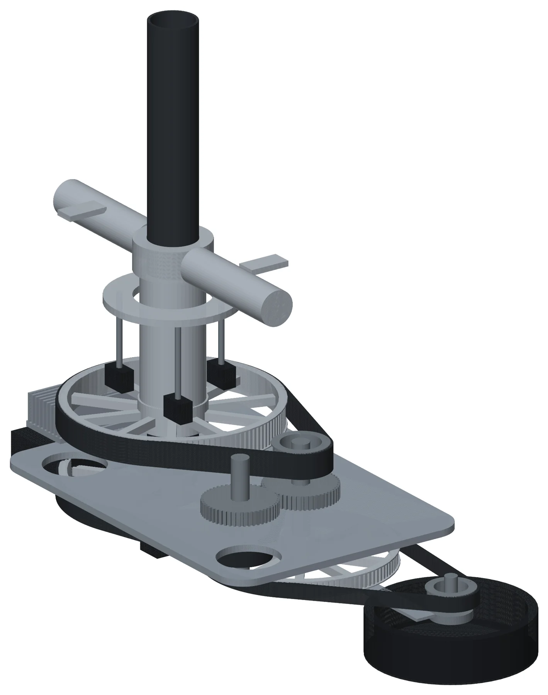

# Coaxial rotor head, air-guide ring (PK), collective

**Status:** 🔄 **rev K in design** — hubs integrated with blade grips, pitch bearings recalculated; collective with 5 electric actuators as before ([rev K](../../docs/design-rev-K.md)). Rev J2 files below are **archive**.

**Onshape document:** _link to be added_

## Files

**Production files (rev J2 — archive):** [J1 – drive unit rev J2](../../production/mechanical/J1-drive-revJ2/) · [ZIP](../../production/downloads/HELIMAC_J1_drive_revJ2.zip) · [J3 – frame, seat, PK ring, lower collective rev J2](../../production/mechanical/J3-frame-seat-revJ2/) · [ZIP](../../production/downloads/HELIMAC_J3_frame_seat_revJ2.zip)

Rotor hubs and upper collective (C07 rod) are in J1; lower collective (C10 ring, actuators) and the PK air-guide ring (6 printable segments) are in J3.

## CAD graphics (rev K — current)

From the rev K concept model (23 Nov 2026) — calculated, not measured.

  
*Drive unit: motor, 16:1 belt drive, reversing gears, lower rotor hub*

PDF: [HELIMAC_revK_2_naped.pdf](../../docs/graphics/revK/HELIMAC_revK_2_naped.pdf)

## Notes

## Open questions
