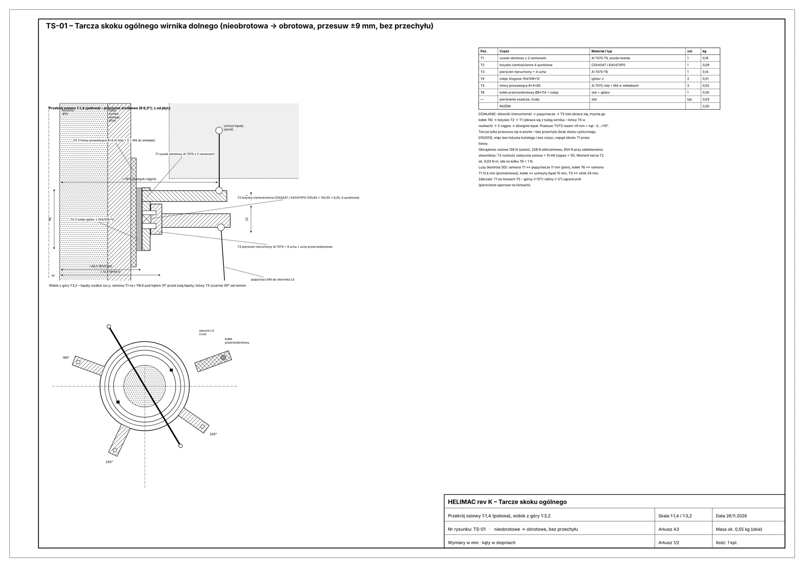

# Coaxial rotor head, air-guide ring (PK), collective

**Status:** 🔄 **rev K — recommended (D22–D25), awaiting approval**: hub with integrated pitch spindle (2 × HK4020 + 51107, no elastomers), both rotors variable pitch −2…+15°, 5 × STS3250, non-tilting collective rings, 3D check 0 collisions ([update 26 Nov](../../docs/design-rev-K-2026-11-26.md#6-collective-pitch-control-d22--recommendation)). Rev J2 files below are **archive**.

**Onshape document:** _link to be added_

## Files

**Production files (rev J2 — archive):** [J1 – drive unit rev J2](../../production/mechanical/J1-drive-revJ2/) · [ZIP](../../production/downloads/HELIMAC_J1_drive_revJ2.zip) · [J3 – frame, seat, PK ring, lower collective rev J2](../../production/mechanical/J3-frame-seat-revJ2/) · [ZIP](../../production/downloads/HELIMAC_J3_frame_seat_revJ2.zip)

Rotor hubs and upper collective (C07 rod) are in J1; lower collective (C10 ring, actuators) and the PK air-guide ring (6 printable segments) are in J3.

## Drawings 26 Nov 2026 (hub, collective control, actuators, rings — recommended)

⚠️ Drawings SK-01 and SK-02 still show a joint radius of 100 mm — correct value **116.6 mm at 31°** (see MS and TS).

PDF (A3): [HELIMAC_revK_PD_piasta_mocowanie_lopaty.pdf](../../docs/graphics/revK/2026-11-26/HELIMAC_revK_PD_piasta_mocowanie_lopaty.pdf) · [HELIMAC_revK_SK_sterowanie_skokiem.pdf](../../docs/graphics/revK/2026-11-26/HELIMAC_revK_SK_sterowanie_skokiem.pdf) · [HELIMAC_revK_MS_montaz_silownikow.pdf](../../docs/graphics/revK/2026-11-26/HELIMAC_revK_MS_montaz_silownikow.pdf) · [HELIMAC_revK_TS_tarcze_skoku.pdf](../../docs/graphics/revK/2026-11-26/HELIMAC_revK_TS_tarcze_skoku.pdf)

  
*PD-01 — hub and blade attachment*

  
*SK-03 — collective control*

  
*MS-01 — actuator mounting, collision check*

  
*TS-01 — lower rotor collective ring*

## CAD graphics (rev K concept, 23 Nov 2026)

From the rev K concept model (23 Nov 2026) — calculated, not measured.

  
*Drive unit: motor, 16:1 belt drive, reversing gears, lower rotor hub*

PDF: [HELIMAC_revK_2_naped.pdf](../../docs/graphics/revK/HELIMAC_revK_2_naped.pdf)

## Notes

## Open questions
