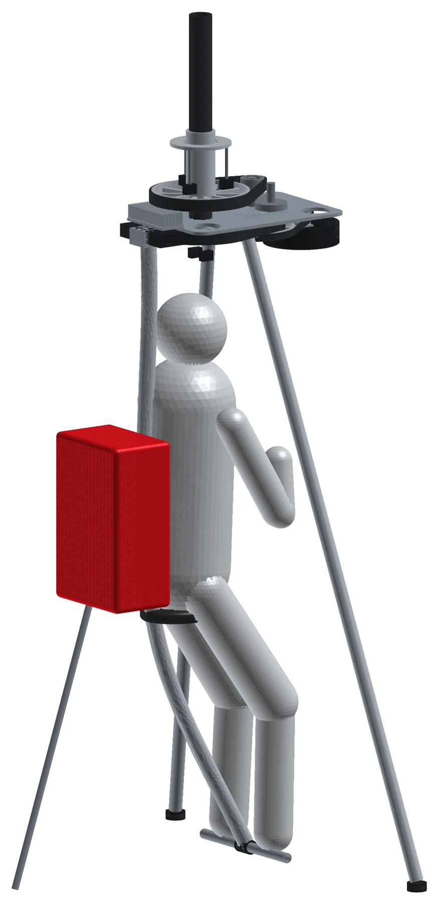

# Seat, harness, battery mount

**Status:** 🔄 **rev K in design** — seat, footrest and battery carried by the curved rear frame leg ([rev K](../../docs/design-rev-K.md)). Rev J2 files below are **archive**.

**Onshape document:** _link to be added_

## Files

**Production files (rev J2 — archive):** [J3 – frame, seat, PK ring, lower collective rev J2](../../production/mechanical/J3-frame-seat-revJ2/) · [ZIP](../../production/downloads/HELIMAC_J3_frame_seat_revJ2.zip)

Seat with harness points, CFRP spine Ø45 × 2, footrest 450 mm, battery mount 50 mm aft — drawings in J3 `01_RYSUNKI/`, STEP in the ZIP.

## CAD graphics (rev K — current)

From the rev K concept model (23 Nov 2026) — calculated, not measured.

  
*Frame of 3 aluminium tubes: front triangle, rear leg curved towards the feet carrying seat, footrest and battery*

PDF: [HELIMAC_revK_1_maszyna.pdf](../../docs/graphics/revK/HELIMAC_revK_1_maszyna.pdf)

## Notes

## Open questions
