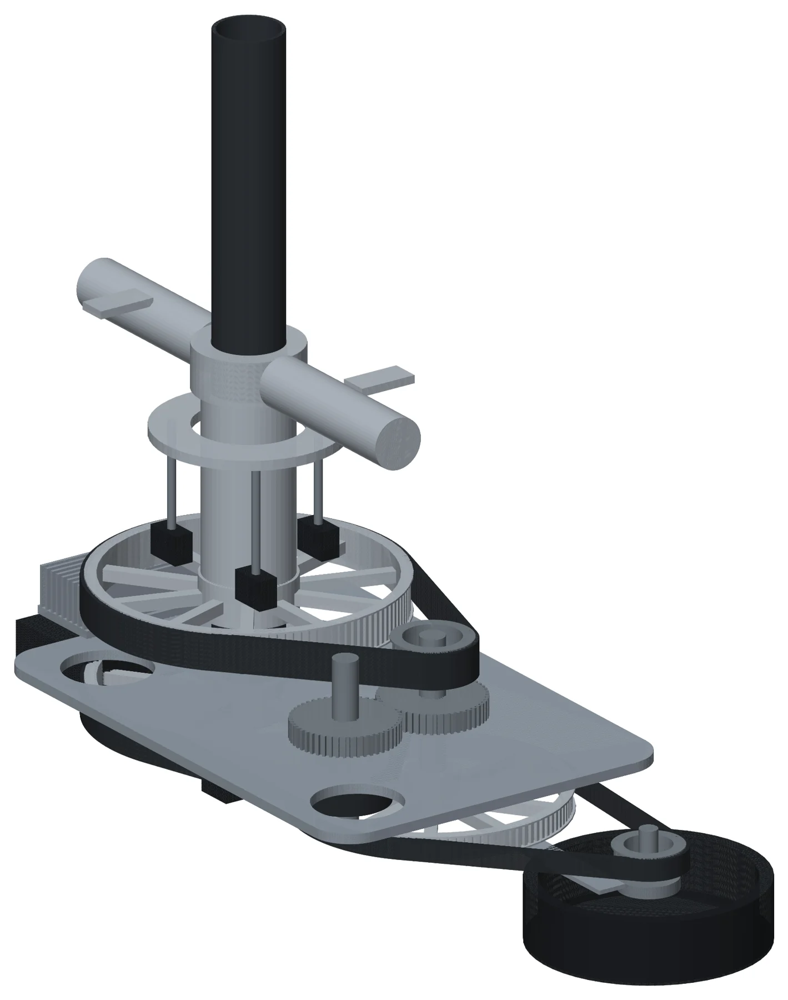
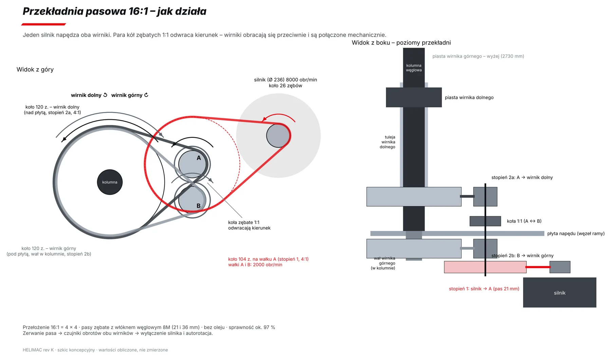
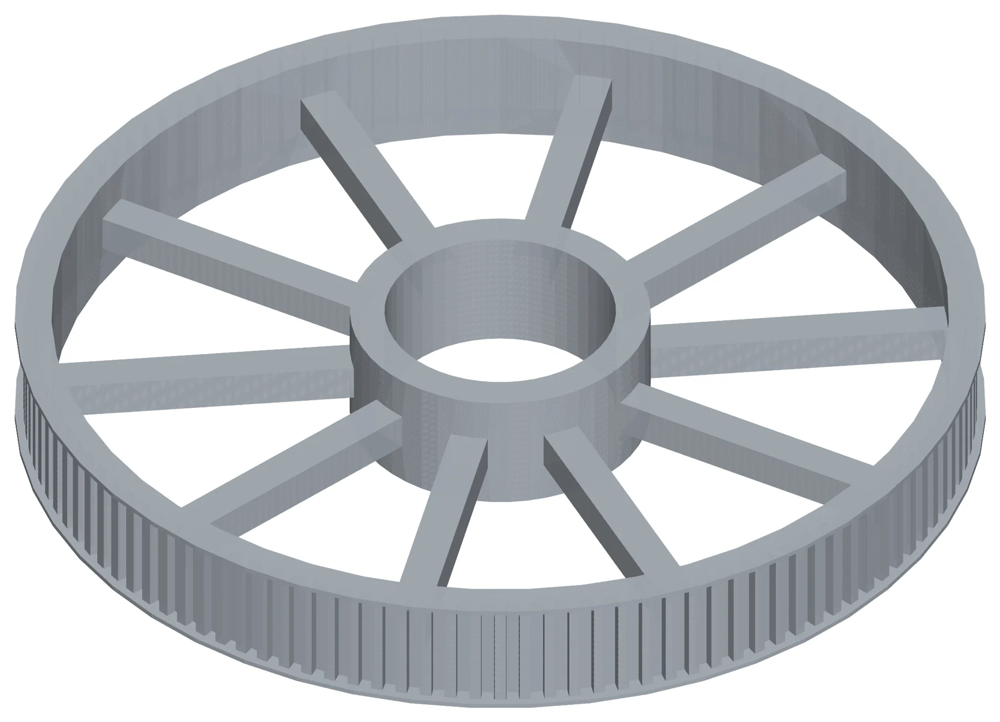
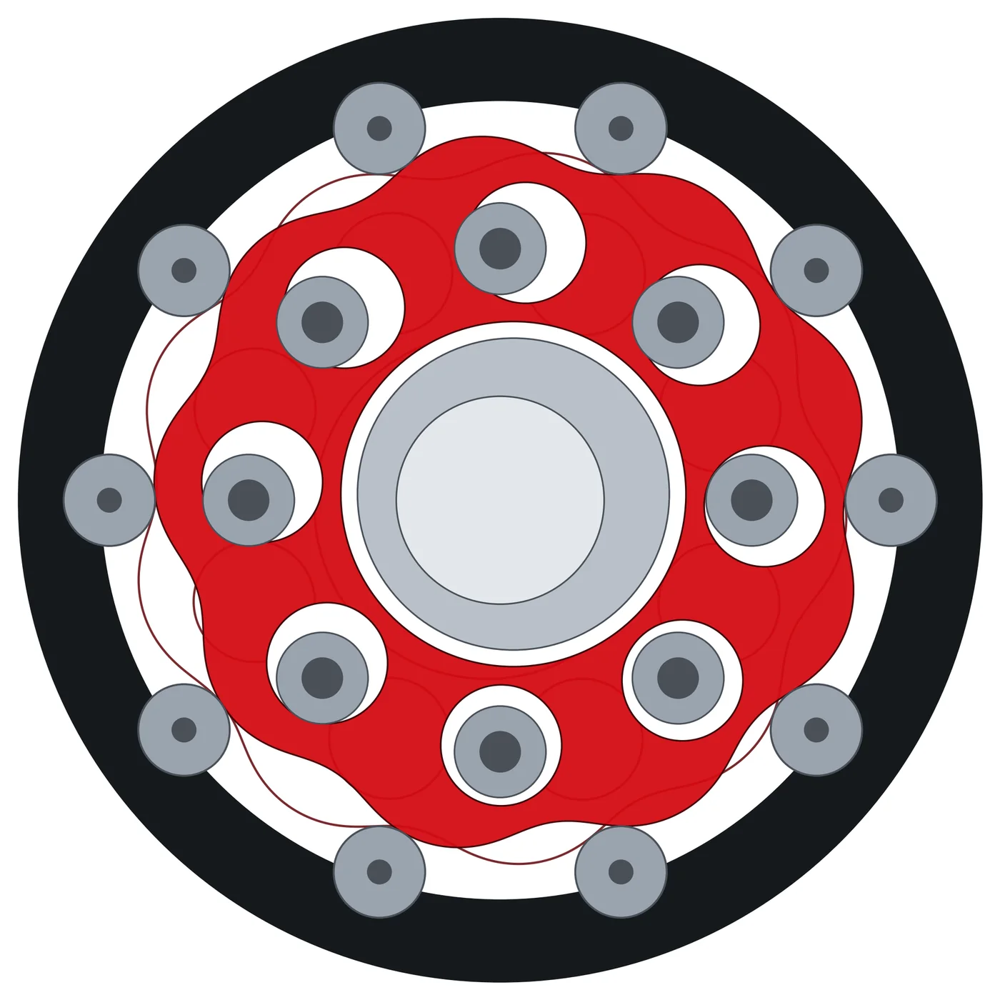

# Cycloidal transmission

**Status:** 🛑 **Rev J2 cycloidal + bevel gearbox — archive, do not build.** Rev K uses a **toothed-belt drive 16:1** (carbon-cord belts, 10-spoke milled Al pulleys, no oil) — in design ([rev K](../../docs/design-rev-K.md)).

**Onshape document:** _link to be added_

## Files

**Production files (rev J2 — archive):** [J1 – drive unit rev J2](../../production/mechanical/J1-drive-revJ2/) · [ZIP](../../production/downloads/HELIMAC_J1_drive_revJ2.zip)

Cycloidal transmission P01–P17 (cams P01 as DXF, 100Cr6) and reversing bevel gearbox N01–N12 — part drawings, assembly drawings, change notes ECN-J01…J03.

## CAD graphics (rev K — current)

From the rev K concept model (23 Nov 2026) — calculated, not measured.

  
*Drive unit: motor, 16:1 belt drive, reversing gears, lower rotor hub*

  
*How the belt drive works – top view and levels*

  
*120-tooth pulley with 10 milled spokes (approx. 1.4 kg)*

PDF: [HELIMAC_revK_2_naped.pdf](../../docs/graphics/revK/HELIMAC_revK_2_naped.pdf)

## CAD graphics (rev J2 — archive)

From the rev J2 CAD model (design chat, 22.11.2026). Click an image for full size.

  
*Section: eccentric sleeve, cams on needle cages, rollers on pins and the lower rotor main bearing*

  
*Two cams offset by 180° and 8 output pins*

  
*Meshing diagram: cam and 10 rollers in the housing*

## Notes

## Open questions
