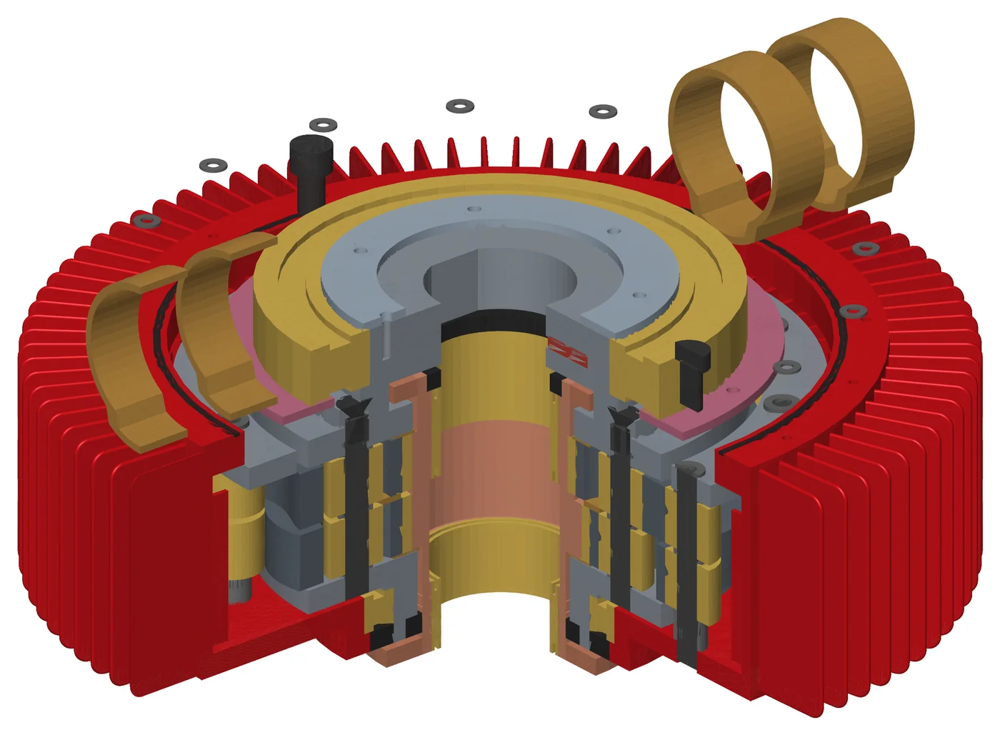
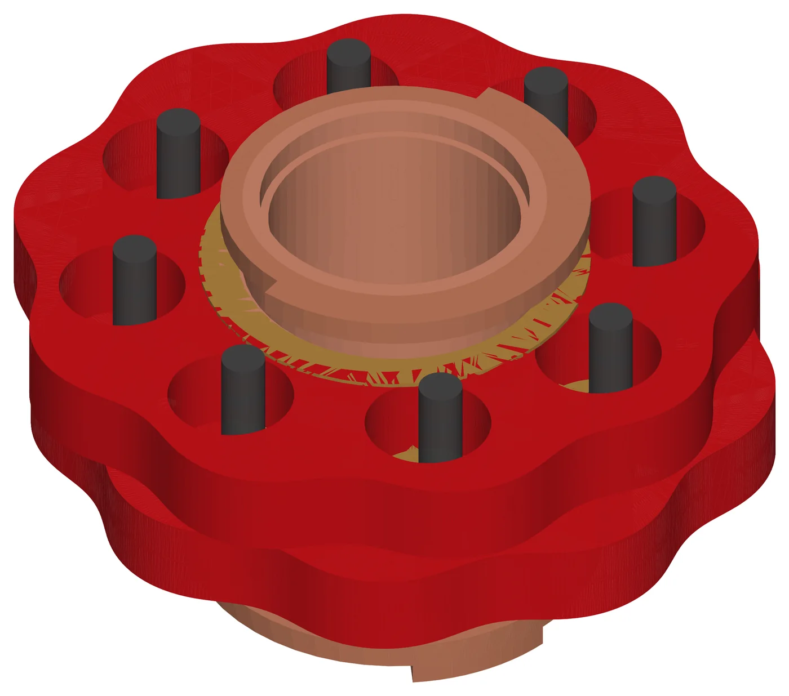

# Cycloidal transmission

**Status:** 📐 rev J2 designed — CAD graphics below; source files to be published

## CAD graphics (rev J2)

From the rev J2 CAD model (design chat, 22.11.2026). Click an image for full size.

  
*Section: eccentric sleeve, cams on needle cages, rollers on pins and the lower rotor main bearing*

  
*Two cams offset by 180° and 8 output pins*

  
*Meshing diagram: cam and 10 rollers in the housing*

**Onshape document:** _link to be added_

## Files

| File | Description | Status | Revision |
|---|---|---|---|
| | | | |

## Notes

## Open questions
